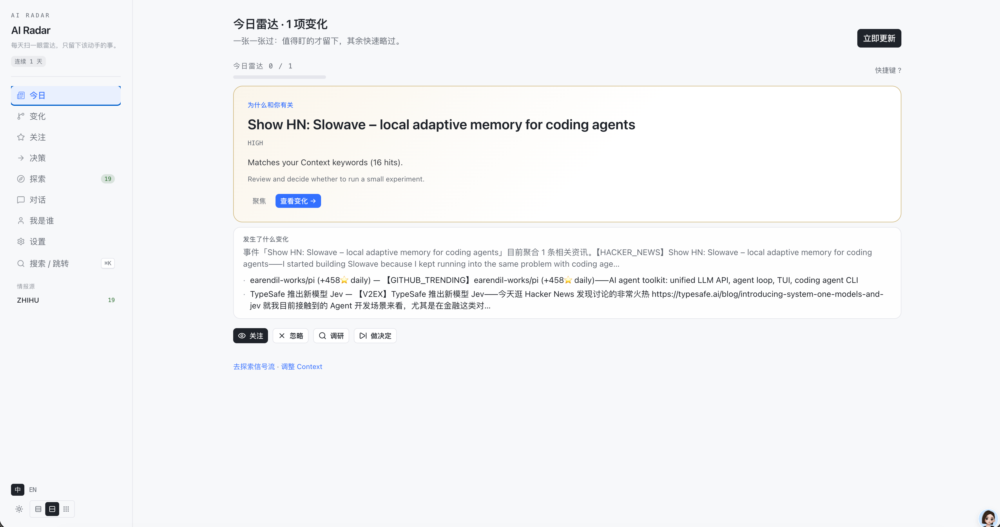
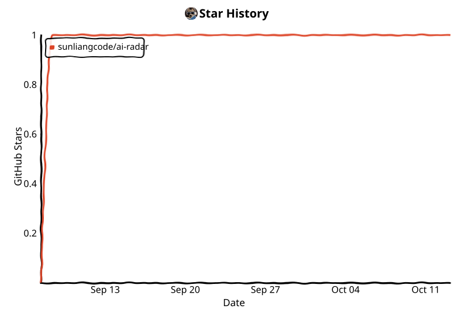

English | [中文](README.zh.md)

[](LICENSE)
[](https://github.com/sunliangcode/ai-radar/actions/workflows/ci.yml)


# AI Radar

### Personal AI Intelligence Radar

```
Context → Signal → Change → Decision → Review on Today
```

Know what changed. Know why it matters. Decide what to do.

[Demo](#demo)
· [Quick Start](#quick-start)
· [Documentation](#documentation)

**Stack:** Java 21 · Spring Boot 3 · SQLite · React/Vite/Tailwind · OpenAI-compatible LLM (default: local Ollama) · Argos Translate (en→zh titles)

---

### Why AI Radar?

Most AI news is noise. AI Radar filters that noise against your context and surfaces only **changes** worth your attention — then helps you decide what to do.

- ✓ **Today** — Daily home: 3–5 Changes that matter, why they matter, and what you can do
- ✓ **Personal Context** — Profile, projects, and stack so relevance is about *you*
- ✓ **Radar** — Browse-first waterfall feed with light save / skip feedback; Changes on demand
- ✓ **CN sources first** — Empty DB seeds `ai-cn` (Zhihu / Weibo / Bilibili CLI + CN RSS / V2EX / …)
- ✓ **Decisions** — Record Observe / Act choices and revisit when needed
- ✓ **Chat** — Interpreter for a Change (seed via Ask AI), not a second feed
- ✓ **Briefs** — Push artifact / archive (`/briefs/:date`), not a primary nav page
- ✓ **Settings → System** — Health and AI monitor for self-host diagnostics

---

### Demo



- **What changed** — What truly mattered in the AI world today?
- **Why care** — Why does this matter for *your* projects and stack?
- **What to do** — Follow, ask AI, explore, or decide — then revisit when needed.

**Demo story**

1. Open **Settings → Context** and describe your role, projects, and tech stack; set your primary language.
2. Import a source pack if needed, then **Update once**.
3. On **Today**, work through Changes that matter (**Explore** / **Ask AI** / **Follow** / **Not now**).
4. Use **Radar** to search Changes or scan Signals; jump into **Chat** from a Change.
5. Check **Settings → System** for self-host diagnostics.

---

## Quick Start

**Option A — One-box (recommended)**

```bash
git clone https://github.com/sunliangcode/ai-radar.git
cd ai-radar
./install.sh
```

Open [http://localhost:8080](http://localhost:8080).

```bash
./scripts/status.sh    # health snapshot (human)
./bin/ai-radar doctor  # prereq + health (JSON)
./bin/ai-radar health  # JSON /api/health only
./scripts/backup.sh    # WAL-safe DB backup → data/backups/ (AI_RADAR_DB / BACKUP_KEEP)
./stop.sh              # stop background processes from install.sh
make help              # contributor shortcuts (check / status / health / …)
```

**Option B — Docker**

```bash
cp backend/.env.example backend/.env
docker compose up -d --build
```

Argos Translate on `:8765`, AI Radar on `:8080`. Details: [docs/installation.md](docs/installation.md).

**Option C — Dev mode**

```bash
# Backend (http://localhost:8080)
cd backend && cp .env.example .env   # first time
./mvnw spring-boot:run

# Frontend (http://localhost:5173, proxies /api → :8080)
cd frontend && npm install && npm run dev
```

Environment variables, delivery channels, and more: [docs/installation.md](docs/installation.md).

## Choose how to run it

| Entry | Status | One-liner | Doc |
|-------|--------|-----------|-----|
| CLI | **Core** | Ops (`./bin/ai-radar doctor` · connectors · pack · fetch · …) | [CLI Reference](docs/cli.md) |
| HTTP API | **Core** | Spring REST + OpenAPI / Swagger | [api.md](docs/api.md) |
| Cursor Skill | **Core** | Agent runs local ops and intelligence queries | [SKILL.md](SKILL.md) |
| Claude / Codex / Gemini | **Core** | Platform-specific skill copies | [skills/](skills/) |
| MCP | **Core** | stdio: `get_health`, `probe_llm`, home, events, sources, connectors, delivery; optional writes | [mcp.md](docs/mcp.md) |
| Web App | **Core** | Full SPA (`:8080` or Vite `:5173`) | [installation.md](docs/installation.md) |

## Documentation

- [Docs index](docs/README.md)
- [Installation & operations](docs/installation.md)
- [CLI](docs/cli.md) · [Agents](docs/agents.md) · [Development](docs/development.md)
- [Sources & packs](docs/sources.md)
- [API](docs/api.md)
- [Architecture / domain](docs/ai-radar-2.0-domain.md)
- [Extensibility overview](docs/extensibility.md) · [Connectors](docs/extending-connectors.md) · [Delivery](docs/extending-delivery.md)
- [Release checklist](docs/release.md)
- [MCP](docs/mcp.md)
- [Contributing](CONTRIBUTING.md) · [Code of Conduct](CODE_OF_CONDUCT.md) · [Support](SUPPORT.md) · [Security](SECURITY.md) · [Changelog](CHANGELOG.md) · [Cite](CITATION.cff)

## License

MIT — see [LICENSE](LICENSE).

Third-party translation stack (Argos Translate / models): [THIRD_PARTY_NOTICES.md](THIRD_PARTY_NOTICES.md).

## Star History

GitHub restricted public stargazer API access in 2026, so hosted `api.star-history.com` badges no longer work for most repos. This chart is generated by [`.github/workflows/star-history.yml`](.github/workflows/star-history.yml) and committed into the repo.

<!-- star-history:start -->
<picture>
  <source media="(prefers-color-scheme: dark)" srcset="assets/star-history/star-history-dark.svg">
  
</picture>
<!-- star-history:end -->
