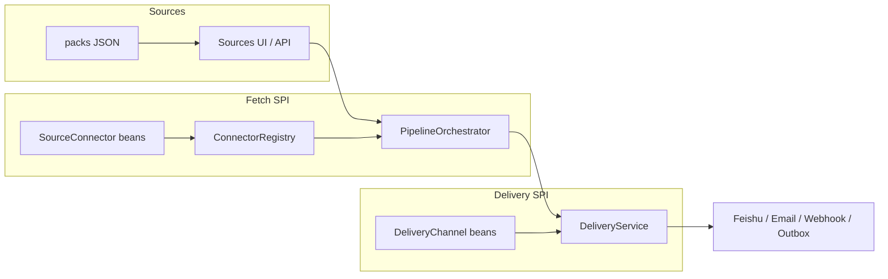

# Extensibility overview

AI Radar is extended **in-repo** via Spring `@Component` beans — not external JARs or Java `ServiceLoader` (yet). Two primary SPIs:

| SPI | Interface | Registry / collector | Doc |
| --- | --- | --- | --- |
| Source connectors | `SourceConnector` | `ConnectorRegistry` → `PipelineOrchestrator` | [extending-connectors.md](extending-connectors.md) |
| Delivery channels | `DeliveryChannel` | `DeliveryService` (injects `List<DeliveryChannel>`); catalog `GET /api/delivery/channels` | [extending-delivery.md](extending-delivery.md) |

Packs (`packs/sources/*.json`) configure **instances** of connector types; they do not define new type codes. Authoring walkthrough: [sources.md — 15-minute pack](sources.md#15-minute-pack-walkthrough).

---

## Architecture



### Connector path

1. Implement `SourceConnector` as a `@Component` under `com.airadar.connector` (or any scanned package).
2. New type codes: add `SourceType` enum value (persistence today uses the enum).
3. `ConnectorRegistry` indexes by trimmed `typeCode()`; blank/duplicate codes, surrounding whitespace on ids/names/keys, blank `displayName`, or blank/duplicate config-field keys fail startup.
4. UI field schemas come from `descriptor()` → `GET /api/connectors` (catalog id must equal `type()`).
5. Orchestrator calls `fetch(FetchContext)` per enabled source; failures are isolated per source.

**15-minute path:** [extending-connectors.md](extending-connectors.md#15-minute-connector-walkthrough).

### Delivery path

1. Implement `DeliveryChannel` as a `@Component` under `com.airadar.delivery`.
2. `channel()` must be unique (case-insensitive); blank/duplicate, surrounding whitespace on ids/names/keys, blank `displayName`, or blank/duplicate `settingsKeys` fail startup. Catalog sorted case-insensitively.
3. `isEnabled()` must be `false` when credentials/config are missing.
4. `DeliveryService` filters enabled channels and calls `deliver(BriefPayload)` on push.
5. Prefer Event cards from `payload.events()`; fall back to `payload.items()`.

**15-minute path:** [extending-delivery.md](extending-delivery.md#15-minute-delivery-walkthrough).

---

## Pluggability limits (honest)

| Supported today | Not yet |
| --- | --- |
| Drop-in `@Component` in this repo | External connector JAR / classpath plugin |
| Pack JSON for source presets | Marketplace of third-party packs |
| Descriptor-driven Sources UI fields | Hot-reload without restart |
| Outbox for local push smoke | Multi-tenant delivery routing |

When adding a surface, keep [CLI](cli.md) / [MCP](mcp.md) / [API](api.md) docs in sync if agents or scripts should see it.

---

## Verify

```bash
./bin/ai-radar doctor                 # soft-checks SPI catalogs (sorted/unique/`BUILTIN_CONNECTOR_PAIRS` + `BUILTIN_DELIVERY_SETTINGS`/no padded ids)
./scripts/status.sh                   # same catalog soft-checks + PIDs/ports
./bin/ai-radar connectors | jq '.[].id'          # == typeCode()
./bin/ai-radar delivery-channels | jq .
# or Swagger tags Health / Connectors / Delivery: http://127.0.0.1:8080/swagger-ui.html
# Field tables: shared/spi-catalog.mjs · OpenAPI blurbs: SpiCatalogBlurbs.java

# Push (includes enabled delivery channels; outbox default on)
./bin/ai-radar push

# Extensibility smoke (FIXTURE → fetch → cluster → push)
./scripts/smoke-extensibility.sh
```

## Related

- [development.md](development.md) · [sources.md](sources.md) · [release.md](release.md) · [cli.md](cli.md) · [api.md](api.md)
